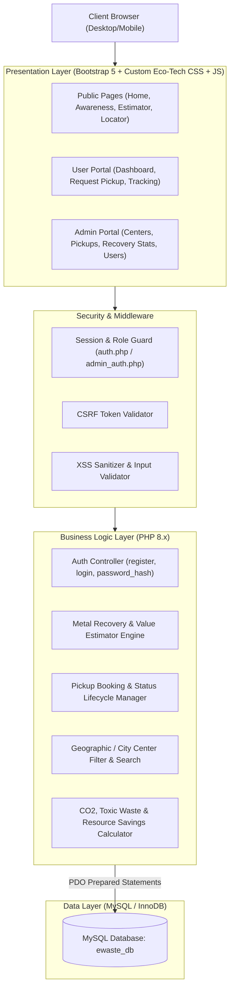
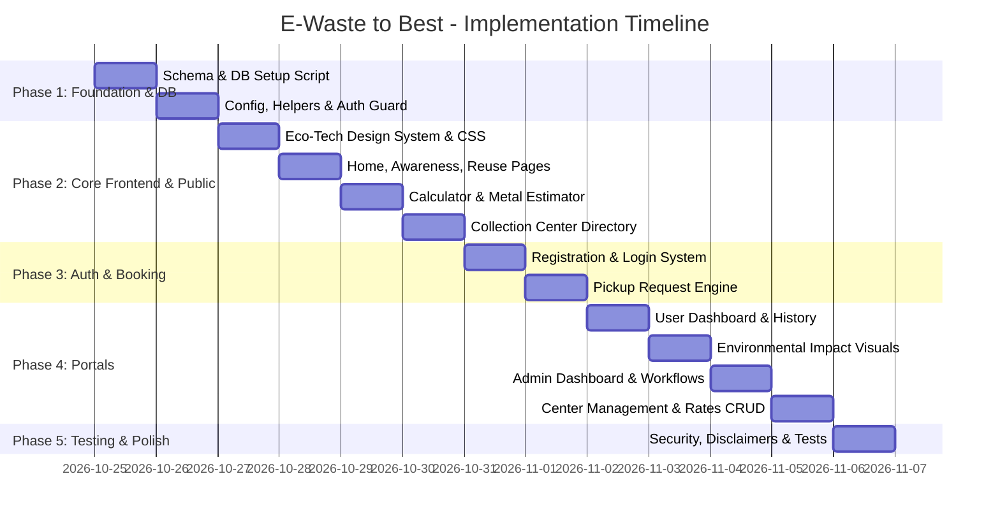

# Project Blueprint: E-Waste to Best
## Smart E-Waste Recycling & Metal Recovery System

**Project Type:** College Final Year / Major Academic Project  
**Architecture:** Monolithic Modular PHP (MVC-lite) with RESTful internal endpoints  
**Frontend:** HTML5, CSS3, JavaScript (ES6+), Bootstrap 5.3, Bootstrap Icons, Chart.js  
**Backend:** PHP 8.x (Vanilla / Object-Oriented PDO)  
**Database:** MySQL (InnoDB engine, utf8mb4)  
**Target Environment:** Local XAMPP (`Apache 2.4` + `MySQL/MariaDB`)  

---

## 1. System Architecture



### Architectural Principles:
1. **Clean Separation of Concerns:** Core includes reusable partials (header, navbar, footer, sidebar), configuration constants (`config/db.php`), authentication helpers (`helpers/auth.php`), and calculation formulas (`helpers/calculations.php`).
2. **Security-First Approach:**
   - Database operations use **PDO with prepared statements** exclusively to prevent SQL injection.
   - Passwords hashed using `PASSWORD_DEFAULT` (bcrypt / argon2).
   - Session fixation protection with `session_regenerate_id()`.
   - HTML output sanitization via `htmlspecialchars()` to prevent XSS.
   - CSRF tokens on all POST forms.
3. **Estimation vs. Reality Transparency:**
   - Metal yields are explicitly flagged as **"Theoretical Mathematical Estimates"** based on baseline industry averages (e.g., printed circuit board gold/silver/copper averages per kg from USGS and EPA reports).
   - Pickups have distinct lifecycle statuses: `Pending Verification`, `Approved`, `Out for Collection`, `Collected`, `Verified at Facility`, and `Cancelled`. Value payouts or certificates are only generated after physical center verification.

---

## 2. Complete Page List

### A. Public Pages (Accessible to All Visitors)
1. **`index.php` (Home):**
   - Hero banner with dynamic call-to-actions ("Estimate Recovery Value" & "Schedule Pickup").
   - Live platform impact counters (Total E-Waste Processed, Est. CO₂ Offset, Recovered Gold/Copper).
   - Interactive feature cards & workflow breakdown ("From Scrap to Best").
   - Quick metal rate ticker (dynamic average commodity prices for Au, Ag, Cu, Al).
2. **`awareness.php` (E-Waste Info & Eco-Awareness):**
   - Hazards of toxic e-waste (Lead, Mercury, Cadmium, Brominated Flame Retardants).
   - Visual lifecycle of electronic items.
   - Eco-tips and proper disposal guidelines under global WEEE standards.
3. **`reuse-tips.php` (Recycling & Reuse Suggestions):**
   - Categorized directory of device refurbishment suggestions before scrapping (laptops, phones, old PCBs, cables).
   - "Repair or Recycle" interactive decision-tree assistant.
4. **`estimator.php` (Metal Recovery & Value Calculator):**
   - Multi-device selector (Motherboards, Smartphones, RAM, Laptops, CRT/LCD monitors, Cables, Hard drives).
   - Quantity / weight input in kg or units.
   - Dynamic JavaScript calculation preview + server-side computation.
   - Estimated yield breakdown for **Gold (Au)**, **Silver (Ag)**, **Copper (Cu)**, and **Aluminium (Al)** with current benchmark scrap pricing.
   - Prominent scientific disclaimer distinguishing estimated potential from assayed laboratory yields.
5. **`centers.php` (Collection Centre Locator):**
   - Filter by City / State / Pincode.
   - Interactive list of verified physical drop-off facilities with operating hours, accepted device types, contact details, and location maps.
6. **`register.php` & `login.php` (Authentication):**
   - Secure registration with validation (Name, Email, Phone, Address, City, Password).
   - Role-based redirect (Admins to `/admin/dashboard.php`, Users to `/user/dashboard.php`).
   - "Demo Credentials" toggle for college viva/demonstration ease.

---

### B. User Portal (Requires User Login)
7. **`user/dashboard.php`:**
   - Summary statistics: Total items submitted, estimated metals recovered, ecological footprint score (trees saved, toxic landfill diverted).
   - Recent pickup requests table with live status badges.
8. **`user/pickup-request.php`:**
   - Smart booking form: Item categories, estimated weight/count, preferred pickup date/time slot, pickup address (autofilled from profile or custom), and nearest authorized center selection.
   - Real-time estimated metal recovery preview before submitting.
9. **`user/history.php`:**
   - Comprehensive log of past and active collection requests.
   - Detailed request view modal with status timeline and physical verification receipts (printable PDF/HTML receipt).
10. **`user/impact.php`:**
    - Personal environmental impact dashboard with graphical Chart.js visualizers: Carbon offset (kg CO₂e), Heavy metals prevented from groundwater, and Precious metals reclaimed.
11. **`user/profile.php`:**
    - Update personal info, address, phone number, and password.

---

### C. Admin Portal (Requires Admin Login)
12. **`admin/dashboard.php`:**
    - Key metrics overview: Total registered users, pending pickups, completed collections, cumulative estimated vs verified recovered metals.
    - System charts: Monthly pickup volume and device category distribution.
13. **`admin/pickups.php`:**
    - Pickup request management: Filter by status (`pending`, `assigned`, `completed`, `cancelled`).
    - Actions: Update status, assign collection center/agent, record verified weight and actual metal recovery upon laboratory intake.
14. **`admin/centers.php`:**
    - Full CRUD management of collection centers (Add, Edit, Delete, Toggle Active/Inactive, manage address and contact).
15. **`admin/metal-rates.php`:**
    - Admin configurable market rates per gram/kg for Gold, Silver, Copper, and Aluminium to keep calculator estimates up to date.
16. **`admin/users.php`:**
    - User list management with search, status view, and role delegation.

---

## 3. Database Design (`ewaste_db`)

```sql
-- Database: ewaste_db
CREATE DATABASE IF NOT EXISTS `ewaste_db` DEFAULT CHARACTER SET utf8mb4 COLLATE utf8mb4_unicode_ci;
USE `ewaste_db`;

-- 1. Users Table (Role-based: 'user' vs 'admin')
CREATE TABLE IF NOT EXISTS `users` (
  `id` INT AUTO_INCREMENT PRIMARY KEY,
  `fullname` VARCHAR(100) NOT NULL,
  `email` VARCHAR(120) NOT NULL UNIQUE,
  `password` VARCHAR(255) NOT NULL,
  `phone` VARCHAR(20) NOT NULL,
  `address` TEXT NOT NULL,
  `city` VARCHAR(60) NOT NULL,
  `pincode` VARCHAR(10) NOT NULL,
  `role` ENUM('user', 'admin') DEFAULT 'user',
  `created_at` TIMESTAMP DEFAULT CURRENT_TIMESTAMP,
  `updated_at` TIMESTAMP DEFAULT CURRENT_TIMESTAMP ON UPDATE CURRENT_TIMESTAMP
) ENGINE=InnoDB;

-- 2. Collection Centers Table
CREATE TABLE IF NOT EXISTS `collection_centers` (
  `id` INT AUTO_INCREMENT PRIMARY KEY,
  `center_name` VARCHAR(150) NOT NULL,
  `contact_person` VARCHAR(100) NOT NULL,
  `phone` VARCHAR(25) NOT NULL,
  `email` VARCHAR(100) NOT NULL,
  `address` TEXT NOT NULL,
  `city` VARCHAR(60) NOT NULL,
  `state` VARCHAR(60) NOT NULL,
  `pincode` VARCHAR(10) NOT NULL,
  `operating_hours` VARCHAR(100) DEFAULT '9:00 AM - 6:00 PM (Mon-Sat)',
  `accepted_items` TEXT COMMENT 'Comma separated categories',
  `latitude` DECIMAL(10, 7) NULL,
  `longitude` DECIMAL(10, 7) NULL,
  `is_active` TINYINT(1) DEFAULT 1,
  `created_at` TIMESTAMP DEFAULT CURRENT_TIMESTAMP
) ENGINE=InnoDB;

-- 3. Device Categories & Metal Yield Benchmark Reference Table
-- (Average recoverable metal yields per unit or per kg based on baseline WEEE/EPA research)
CREATE TABLE IF NOT EXISTS `device_categories` (
  `id` INT AUTO_INCREMENT PRIMARY KEY,
  `category_name` VARCHAR(100) NOT NULL,
  `unit_type` ENUM('unit', 'kg') DEFAULT 'unit',
  `description` VARCHAR(255),
  `copper_yield_g` DECIMAL(10, 4) DEFAULT 0.0000 COMMENT 'Grams of Copper per unit/kg',
  `aluminium_yield_g` DECIMAL(10, 4) DEFAULT 0.0000 COMMENT 'Grams of Aluminium per unit/kg',
  `silver_yield_g` DECIMAL(10, 4) DEFAULT 0.0000 COMMENT 'Grams of Silver per unit/kg',
  `gold_yield_g` DECIMAL(10, 4) DEFAULT 0.0000 COMMENT 'Grams of Gold per unit/kg',
  `co2_saving_kg` DECIMAL(10, 2) DEFAULT 0.00 COMMENT 'Estimated CO2 avoided per unit/kg',
  `is_active` TINYINT(1) DEFAULT 1
) ENGINE=InnoDB;

-- 4. Metal Market Reference Rates Table (for monetary estimates)
CREATE TABLE IF NOT EXISTS `metal_rates` (
  `id` INT AUTO_INCREMENT PRIMARY KEY,
  `metal_name` VARCHAR(50) NOT NULL UNIQUE,
  `symbol` VARCHAR(10) NOT NULL,
  `rate_per_gram` DECIMAL(10, 2) NOT NULL COMMENT 'In INR (or configured currency)',
  `updated_by` INT NULL,
  `last_updated` TIMESTAMP DEFAULT CURRENT_TIMESTAMP ON UPDATE CURRENT_TIMESTAMP,
  FOREIGN KEY (`updated_by`) REFERENCES `users`(`id`) ON DELETE SET NULL
) ENGINE=InnoDB;

-- 5. Pickup Requests Table
CREATE TABLE IF NOT EXISTS `pickup_requests` (
  `id` INT AUTO_INCREMENT PRIMARY KEY,
  `request_code` VARCHAR(25) NOT NULL UNIQUE,
  `user_id` INT NOT NULL,
  `center_id` INT NULL,
  `device_category_id` INT NOT NULL,
  `quantity` DECIMAL(10, 2) NOT NULL COMMENT 'Number of units or kg',
  `pickup_address` TEXT NOT NULL,
  `pickup_city` VARCHAR(60) NOT NULL,
  `pickup_pincode` VARCHAR(10) NOT NULL,
  `preferred_date` DATE NOT NULL,
  `preferred_slot` ENUM('Morning (9AM - 12PM)', 'Afternoon (12PM - 3PM)', 'Evening (3PM - 6PM)') NOT NULL,
  `item_condition` ENUM('Working', 'Partially Working', 'Dead / Scrap') DEFAULT 'Dead / Scrap',
  `special_notes` TEXT NULL,
  
  -- Calculated Theoretical Estimates (Computed at booking time)
  `est_copper_g` DECIMAL(10, 3) DEFAULT 0.000,
  `est_aluminium_g` DECIMAL(10, 3) DEFAULT 0.000,
  `est_silver_g` DECIMAL(10, 4) DEFAULT 0.0000,
  `est_gold_g` DECIMAL(10, 4) DEFAULT 0.0000,
  `est_total_value` DECIMAL(10, 2) DEFAULT 0.00,
  `est_co2_saved_kg` DECIMAL(10, 2) DEFAULT 0.00,

  -- Verified Actual Measurements (Recorded by Admin/Center post-collection)
  `is_verified` TINYINT(1) DEFAULT 0,
  `actual_weight_kg` DECIMAL(10, 2) NULL,
  `actual_copper_g` DECIMAL(10, 3) NULL,
  `actual_aluminium_g` DECIMAL(10, 3) NULL,
  `actual_silver_g` DECIMAL(10, 4) NULL,
  `actual_gold_g` DECIMAL(10, 4) NULL,
  `actual_payout_value` DECIMAL(10, 2) NULL,
  `verification_notes` TEXT NULL,

  -- Status Lifecycle
  `status` ENUM('Pending', 'Assigned', 'Out for Pickup', 'Collected', 'Completed', 'Cancelled') DEFAULT 'Pending',
  `admin_remarks` TEXT NULL,
  `created_at` TIMESTAMP DEFAULT CURRENT_TIMESTAMP,
  `updated_at` TIMESTAMP DEFAULT CURRENT_TIMESTAMP ON UPDATE CURRENT_TIMESTAMP,

  FOREIGN KEY (`user_id`) REFERENCES `users`(`id`) ON DELETE CASCADE,
  FOREIGN KEY (`center_id`) REFERENCES `collection_centers`(`id`) ON DELETE SET NULL,
  FOREIGN KEY (`device_category_id`) REFERENCES `device_categories`(`id`) ON DELETE RESTRICT
) ENGINE=InnoDB;

-- 6. Environmental Impact Audit Log Table
CREATE TABLE IF NOT EXISTS `impact_logs` (
  `id` INT AUTO_INCREMENT PRIMARY KEY,
  `pickup_id` INT NOT NULL,
  `co2_saved_kg` DECIMAL(10, 2) NOT NULL,
  `toxic_waste_diverted_kg` DECIMAL(10, 2) NOT NULL,
  `precious_metals_reclaimed_g` DECIMAL(10, 3) NOT NULL,
  `logged_at` TIMESTAMP DEFAULT CURRENT_TIMESTAMP,
  FOREIGN KEY (`pickup_id`) REFERENCES `pickup_requests`(`id`) ON DELETE CASCADE
) ENGINE=InnoDB;
```

---

## 4. Folder Structure

```
Waste to best/
├── config/
│   ├── db.php                  # PDO database connection & error handling
│   ├── constants.php           # App name, base URL, currency settings
│   └── seed_data.sql           # Database schema & demo sample data
├── assets/
│   ├── css/
│   │   ├── style.css           # Custom modern eco-tech styling & dark/light accents
│   │   └── admin.css           # Admin dashboard specific layout styles
│   ├── js/
│   │   ├── main.js             # General UI interactivity & tooltips
│   │   ├── estimator.js        # Dynamic live metal & value calculation
│   │   └── chart-configs.js    # Chart.js environmental analytics graphs
│   └── images/                 # SVG icons, eco hero illustrations, device badges
├── includes/
│   ├── header.php              # Standard HTML head, CDN links, meta tags
│   ├── navbar.php              # Responsive Bootstrap navbar with active states
│   ├── footer.php              # Informative footer with quick links & disclaimers
│   ├── auth_check.php          # User session verification guard
│   ├── admin_check.php         # Admin role verification guard
│   ├── csrf.php                # CSRF token generation and validation helpers
│   └── functions.php           # Calculation algorithms, sanitizers, flash messages
├── user/
│   ├── dashboard.php           # User profile stats & recent activity overview
│   ├── pickup-request.php      # Interactive multi-step pickup scheduling form
│   ├── history.php             # Full history of submissions with status badges
│   ├── view-request.php        # Detailed receipt modal / print view for single request
│   ├── impact.php              # Personal green certificate & savings analytics
│   └── profile.php             # Edit profile and password
├── admin/
│   ├── dashboard.php           # High-level stats, charts, pending actions
│   ├── pickups.php             # Manage pickup workflows, statuses & physical receipts
│   ├── verify-pickup.php       # Form to log actual lab-verified weights & recovery
│   ├── centers.php             # Add / Edit / Remove collection centers
│   ├── metal-rates.php         # Configure dynamic metal market benchmark rates
│   └── users.php               # Overview of registered citizens / students
├── index.php                   # Landing homepage with hero, tickers & features
├── awareness.php               # E-waste toxic breakdown & recycling awareness
├── reuse-tips.php              # Circular economy & creative reuse guides
├── estimator.php               # Interactive Metal & Scrap Value Estimator tool
├── centers.php                 # Searchable Collection Centre Locator
├── login.php                   # Authentication login form
├── register.php                # User signup form
├── logout.php                  # Session destruction and redirection
└── README.md                   # Installation & XAMPP setup instructions for college viva
```

---

## 5. Development Phases



### Phase-by-Phase Breakdown:
- **Phase 1: Project Setup & Database Engine**
  - Establish `ewaste_db` SQL script with relational foreign keys.
  - Populate baseline device categories (e.g., Laptops, Mobile Phones, Desktop PCBs, RAM Sticks, Hard Drives) with empirical recovery benchmarks (Gold, Silver, Copper, Aluminium).
  - Seed current indicative metal benchmark prices (Au, Ag, Cu, Al in INR) and realistic collection centers across major Indian cities (e.g., Delhi, Mumbai, Bengaluru, Hyderabad, Pune, Lucknow).
  - Create PDO database wrapper with structured error handling.

- **Phase 2: Modern Eco-Tech Frontend & Public Tools**
  - Construct custom CSS design system: emerald-to-teal gradients, dark slate contrasts, glassmorphic cards, crisp typography (Inter/Outfit via Google Fonts), and responsive navigation.
  - Implement **`index.php`** with live impact ticker and interactive call-to-actions.
  - Implement **`awareness.php`** & **`reuse-tips.php`** featuring actionable guides and interactive cards.
  - Implement **`estimator.php`**: real-time JavaScript calculator syncing with PHP backend calculation engine, rendering bar breakdown and disclaimers.
  - Implement **`centers.php`**: searchable and filterable directory by city and accepted materials.

- **Phase 3: User Authentication & Booking Lifecycle**
  - Secure signup/login with password hashing and session tokens.
  - Create smart **Pickup Request Form** with auto-calculation of estimated recovery, date validation, and city-to-center linking.
  - Generate human-readable request codes (e.g., `EWB-2026-XXXX`).

- **Phase 4: User & Admin Portals**
  - **User Portal:** Dashboard summary, request tracking timeline, printable pickup verification vouchers, and green certificate generator.
  - **Admin Portal:** Live status switcher (`Pending` $\rightarrow$ `Assigned` $\rightarrow$ `Collected` $\rightarrow$ `Completed`), lab verification input form (recording actual grams vs estimated grams), collection center management, and real-time metal price editor.

- **Phase 5: Quality Assurance, Security Hardening & Documentation**
  - Verify CSRF, SQL injection defenses, and XSS sanitization.
  - Check full mobile/tablet/desktop responsiveness.
  - Complete README and step-by-step XAMPP import guide for college presentation and viva.

---

## 6. Testing & Quality Assurance Plan

| Test Category | Target Module | Test Scenario & Verification Criteria |
| :--- | :--- | :--- |
| **Security** | Authentication | Attempt SQL injection in login/register inputs; confirm PDO parameterization blocks them completely. Verify passwords in database are hashed with `password_hash()`. |
| **Security** | Access Control | Attempt direct URL access to `/admin/dashboard.php` as a guest or standard user; verify immediate redirect to `login.php` with an error message. |
| **Security** | CSRF & XSS | Verify CSRF tokens block unauthorized POST submissions. Test script tags in text fields; confirm `htmlspecialchars()` prevents script execution. |
| **Scientific Logic** | Estimator Engine | Input 5 Mobile Phones; verify mathematical yield matches benchmark values (e.g., ~0.12g Au, ~1.25g Ag, ~75g Cu, ~15g Al). Confirm clear disclaimer is shown stating estimates are theoretical. |
| **Workflow** | Pickup Booking | Submit booking; verify unique code generation, correct database entry, and that booking displays on User Dashboard as "Pending" and in Admin queue immediately. |
| **Verification** | Actual vs Estimated | As Admin, open a collected pickup and input verified recovery weights; confirm database flags `is_verified = 1` and User view displays both estimated and verified columns with verification badges. |
| **Responsive UI** | Cross-Device Layout | Test on simulated viewport widths (375px mobile, 768px tablet, 1200px desktop). Verify clean navbar toggle, table scrolling, and readable cards. |
| **Center Locator** | Filter & Search | Filter centers by "Delhi" or "Mumbai"; confirm list refreshes dynamically without page errors or missing data. |
